# ER 図

```mermaid
erDiagram
    symbol_classes ||--o{ annotation_symbols : "class_id"
    annotation_projects ||--o{ annotation_images : "project_id"
    annotation_projects ||--o{ annotation_symbols : "project_id"
    annotation_projects ||--o{ connections : "project_id"
    annotation_symbols ||--o{ symbol_terminals : "symbol_id"
    annotation_symbols ||--o{ connections : "from_symbol_id / to_symbol_id"
    symbol_terminals ||--o{ connections : "from_terminal_id / to_terminal_id"
    annotation_projects ||--o{ predictions : "project_id"
    annotation_projects ||--o| structure_predictions : "project_id"
    annotation_projects ||--o{ table_reviews : "project_id"
    symbol_classes ||--o{ predictions : "class_id"
    ml_models ||--o{ predictions : "model_id"
    ml_models ||--o{ training_runs : "result_model_id"
    drawing_sets ||--o{ drawing_set_members : "set_id"
    annotation_projects ||--o{ drawing_set_members : "project_id"

    symbol_classes {
        int id PK
        string key UK
        string label
        int yolo_index UK
        string color
        bool is_active
        int sort_order
        datetime created_at
    }
    annotation_projects {
        int id PK
        string name
        string sheet_no
        string page_no
        string revision
        string source_file
        int image_width
        int image_height
        string status
        string assignee
        text note
        datetime created_at
        datetime updated_at
    }
    annotation_images {
        int id PK
        int project_id FK
        string filename
        string sha256
        int width
        int height
        datetime created_at
    }
    annotation_symbols {
        int id PK
        int project_id FK
        int class_id FK
        string ref "プロジェクト内で一意"
        string label
        float cx
        float cy
        float w
        float h
        text note
        string origin "manual / inference"
        float confidence "推論由来の信頼度（NULL 可）"
        text attributes_json "メーカー・型式などの属性（DD-0010）"
        float label_cx "ラベルの文字の位置（正規化、NULL 可。DD-0049）"
        float label_cy
        float label_w
        float label_h
        datetime created_at
    }
    symbol_terminals {
        int id PK
        int symbol_id FK
        string name
        float tx
        float ty
        string origin "manual / inference"
    }
    connections {
        int id PK
        int project_id FK
        int from_symbol_id FK
        int from_terminal_id FK "NULL 可"
        int to_symbol_id FK
        int to_terminal_id FK "NULL 可"
        string wire_no
        string net_id
        string kind "wire / sheet_ref"
        string external_ref
        text note
        string origin "manual / inference"
        string ref "図面内で一意（W-0001）"
        text attributes_json "長さ・電線種別などの属性（DD-0010）"
        datetime created_at
    }
    ml_models {
        int id PK
        string name
        int version
        string file_name
        string sha256 "実体は data/models/<sha256>.pt"
        int size_bytes
        string source "upload / trained"
        bool is_active "推論・学習のベース"
        text metrics_json
        text note
        datetime created_at
    }
    predictions {
        int id PK
        int project_id FK
        int model_id FK "NULL 可（外部取込）"
        string model_label
        int class_id FK
        float cx
        float cy
        float w
        float h
        float confidence
        string kind "symbol / region"
        datetime created_at
    }
    structure_predictions {
        int project_id PK "FK"
        text payload_json "構造解析の結果（1 枚 400 KB ほど）"
        int wire_count "一覧用。JSON を書くたびに数え直す"
        int connection_count "一覧用。同上"
        text texts_json "回路用の文字の写し（DD-0042）"
        datetime created_at
    }
    circuit_change_sets {
        int id PK
        string title "変更の題名"
        text reason "NULL 可"
        string author "user / llm / 名前"
        text project_ids_json "対象の図面（その時点の一覧）"
        text ops_json "操作の並び（DD-0034）"
        text notes_json "操作ごとの説明。NULL 可"
        text summary_json "試行の結果の要約。NULL 可"
        text before_json "変更前の図面（取り消しで戻す）"
        string after_hash "変更後の図面のハッシュ"
        string status "applied / undone"
        datetime created_at
        datetime undone_at "NULL 可"
    }
    training_runs {
        int id PK
        string status "running / success / failed"
        text project_ids_json
        int image_count
        int epochs
        int imgsz
        string base_model
        int result_model_id FK "NULL 可"
        text metrics_json
        string decision "pending / adopted / rejected。空は判定なし"
        text baseline_metrics_json "旧モデルの評価指標"
        string baseline_label "旧モデルの表示名"
        text eval_scope_json "評価に使った図面の範囲（holdout / train）"
        text log_tail
        datetime started_at
        datetime finished_at
    }
    drawing_sets {
        int id PK
        string name UK "DD-0041"
        text note
        datetime created_at
        datetime updated_at
    }
    drawing_set_members {
        int set_id PK "FK"
        int project_id PK "FK。1 枚の図面は複数のセットに入れてよい"
    }
    table_reviews {
        int id PK
        int project_id "FK。(project_id, table_key) で一意"
        string table_key "relay_table / title_block"
        string status "draft / confirmed（DD-0051）"
        text grid_json "確かめ始めたときの OCR の格子"
        text values_json "人が直した欄の文字"
        datetime updated_at
        datetime confirmed_at "NULL 可"
    }
```

## 設計方針

### 座標

`annotation_symbols` の `cx, cy, w, h` と `symbol_terminals` の `tx, ty` は
すべて画像サイズで割った**正規化値（0.0〜1.0）**です。YOLO 形式と同じ表現のため、
エクスポート時に変換が不要になります。

ピクセル座標との相互変換は `services/geometry.py` の 1 ファイルに集約しています。
新しい変換処理を書く場合も必ずここを経由させてください。

### `ref` と主キーの使い分け

`annotation_symbols.ref`（`SYM-0001` 等）は**プロジェクト内で一意な参照名**で、
`(project_id, ref)` に UNIQUE 制約を持ちます。
エクスポート／インポートでは DB の主キーではなく `ref` で関係を表現するため、
別環境に取り込んでも配線の from-to が壊れません。

### データ設計で意識した既知リスクへの対応

| 一般的なアノテーション DB で起きがちなリスク | 本ツールでの対応 |
|---|---|
| `class_id は Python 配列の添字で、DB 上の参照先がない` | `symbol_classes` マスタを用意し、`yolo_index` を UNIQUE として明示採番。`annotation_symbols.class_id` は FK |
| `画像を base64 テキストで保存しているため、検索・バックアップ・移行の負荷が高い` | 画像実体は `data/images/<sha256>.png` に保存し、DB にはメタデータ（filename / sha256 / width / height）のみ |
| `親子関係が FK で追跡できない` | 配線は `from_symbol_id` / `to_symbol_id` / `from_terminal_id` / `to_terminal_id` の FK で保持 |

### 削除の伝播

削除の連鎖は DB の外部キー（`ON DELETE CASCADE` / `SET NULL`）が行います。SQLite は
接続ごとに `PRAGMA foreign_keys=ON` を入れないと外部キーが効かないので、`database.py` で
接続のたびに有効にしています（DD-0015 より前は無効で、ORM が子の行をすべて読んでから消していました）。
ORM の relationship は `passive_deletes=True` で、子を読み込まずに親だけ消します。

`annotation_projects` を削除すると、`images` / `symbols` / `connections` /
`predictions` / `structure_predictions` / `drawing_set_members`（図面セットからも外れる。DD-0041）/ `table_reviews`（表の読み取りの確認。DD-0051）が連鎖削除されます。
図面セット（`drawing_sets`）を削除しても図面は残ります。
シンボルを削除すると、その端子と、そのシンボルを含む配線も削除されます。端子を削除すると、
配線の端子の指定（`from_terminal_id` / `to_terminal_id`）は NULL になります。
`ml_models` を削除しても `predictions` / `training_runs` は残り（`model_id` /
`result_model_id` は NULL に）、実体ファイルは他モデルと sha256 を共有しない
場合のみ削除されます。`symbol_classes` は使われている間は削除できません。

### 索引

外部キーの列にはすべて索引を付けています。SQLite は外部キーに自動で索引を作らないので、
無いと連鎖削除のたびに子の表を全件走査します。

| 索引 | 用途 |
|---|---|
| `annotation_symbols (project_id, ref)` 一意 | 図面の記号の読み込み・参照名の一意性 |
| `connections (project_id, ref)` 一意 | 図面の配線の読み込み・参照名の一意性（属性と 1 対 1） |
| `connections (from_symbol_id)` / `(to_symbol_id)` / `(from_terminal_id)` / `(to_terminal_id)` | 記号・端子を消したときの連鎖 |
| `symbol_terminals (symbol_id)` | 記号の端子の読み込み・連鎖 |
| `predictions (project_id, kind)` | 図面の推論結果・件数 |
| `annotation_symbols (class_id)` / `predictions (class_id)` | クラスごとの集計（`/api/stats`）、クラスが使われているかの確認（DD-0042） |
| `predictions (model_id)` / `training_runs (result_model_id)` | モデルを消したときの `SET NULL`（DD-0042） |
| `annotation_images (project_id)` / `(sha256)` | 図面の画像・同じ画像の検索 |
| `ml_models (sha256)` | 同じモデルの検索 |
| `drawing_set_members (project_id)` | 図面を消したときに図面セットから外す連鎖（DD-0041） |

主キーに重ねた索引（`ix_<表>_id`）は作りません（主キーの索引で足ります）。

### 読み込み

図面を読んで `serialize_project` に渡すクエリには `.options(*WITH_ANNOTATIONS)`
（`services/annotation_service.py`）を付けます。記号・端子・配線・画像を表ごとに 1 回のクエリで読み、
行ごとの遅延読み込み（記号 150 個なら端子だけで 150 回のクエリ）をしません。
一覧に出す構造解析の件数は `structure_predictions` の列から読み、JSON は開きません。

回路・対応表・CVAT・図面セットのように何十枚もまとめて読むところは、`annotation_service.load_pages` を使います（DD-0042）。
表ごとに 1 回の SELECT で読み、ORM の行を組み立てずに、`serialize_project` と同じ形の辞書を返します。
回路が使う構造解析の文字（母線の PER/NER など）は `structure_predictions.texts_json` から読み、1 枚 400 KB ほどの
`payload_json` 全体は開きません。`texts_json` は `payload_json` を書くたびに写し（`@validates`。文字が無ければ `"[]"`）、
NULL は「まだ写していない」の意味です。`GET /api/ml/projects/{id}/structure` は保存した JSON をそのまま返します（応答の形は以前と同じ）。

### 既存 DB の移行

`db_migrations.py` の `STEPS` を起動のたびに順に実行します。どの手順も済んでいれば何もしません。
列の追加（DD-0049 のラベルの文字の位置 `annotation_symbols.label_cx/cy/w/h` を含む。NULL 可なので埋め戻しは無く、
戻すときは列を使わないだけでよい）、件数の列の埋め戻し、文字の列（`texts_json`）の埋め戻し（DD-0042）、親の無い行の片付け、配線の参照名の振り直し（欠けと重複）、
索引の作成、主キーに重ねた索引の削除、の順です。

### AI 改善サイクルのデータ

- `predictions` は図面ごとに**最新の推論だけ**を保持する作業領域で、
  人が確認・修正して `annotation_symbols`（`origin=inference`）へ昇格させたものが
  学習データとして蓄積される、という分担です。
- `training_runs` は学習ジョブの実行履歴。成功時は結果の `best.pt` が
  `ml_models` に `source=trained` で登録され、`decision=pending`（採用待ち）になります。
  利用者が新旧の比較を見て採用すると使用中（`is_active`）に切り替わります。比較する使用中のモデルが無い初回だけは
  自動で使用中にします（`decision=adopted`）。
  学習に使った図面は `project_ids_json` に**その時点の一覧**として残します（図面を後で消しても
  履歴は変わらないので、関連の表にはしていません）。

### 回路の変更のデータ（DD-0034）

- `circuit_change_sets` は図面の変更（操作の並び）を適用した記録です。変更前の図面（記号・端子・配線）を `before_json` に
  丸ごと持ち、取り消すとそれに戻します（`status=undone`）。取り消す前に図面が変わっていないかは `after_hash` で確かめます。
- 変更は複数の図面にまたがりうるので、図面との関連は外部キーにせず、`project_ids_json` にその時点の一覧として残します
  （`training_runs.project_ids_json` と同じ考え方）。図面を削除しても履歴は残ります。

### 時刻

`created_at` などの日時の列は、タイムゾーンなしの UTC で保存します（`models.utc_now_naive`）。API・画面・書き出しでは
日本時間（`+09:00`）に直して出します（DD-0036）。DB の移行は不要です。

### DB 変更時の運用ルール

新機能やカラム追加が必要な場合は、コードを書く前に **DB 構造変更案を提示し、承認後に実装**します。
既存テーブルへ安易にカラムを足すのではなく、正規化・既存データ移行・DDL・ロールバック・
インデックス・関連ドキュメントの更新範囲を先に検討してください。
