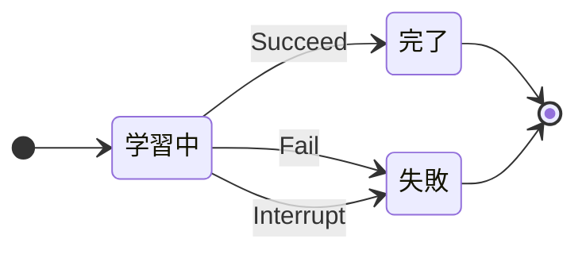
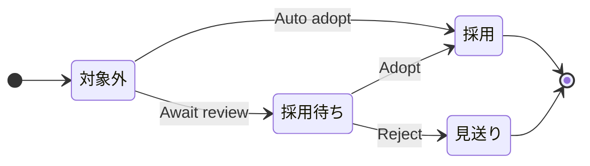
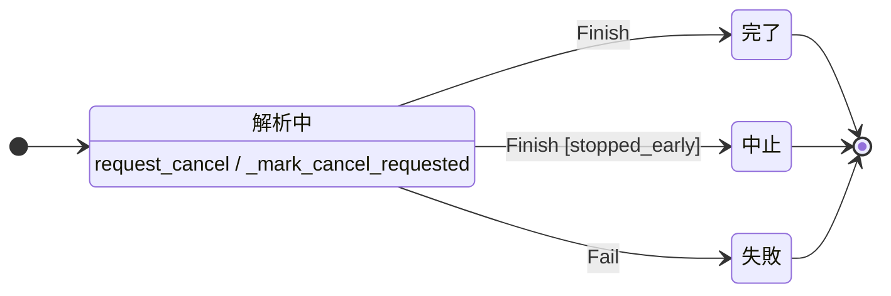
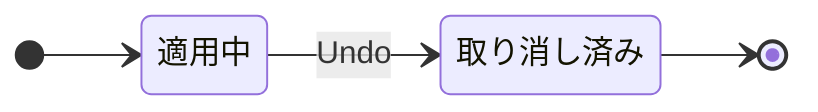
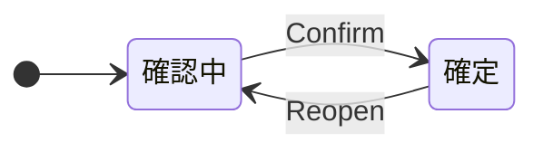

# 状態の移り方（状態図）

このファイルは `python scripts/state_diagrams.py` が `services/lifecycles.py` から作る。手で直さない（DD-0047）。

状態の値は DB・API の文字列そのまま。図の矢印に無い移り方は `TransitionNotAllowed` になる。

## TrainingRun.status（`TrainingRunLifecycle`）

学習ジョブ（TrainingRun.status）。学習のスレッドが終われば成功か失敗のどちらかで止まる。

アプリを止めると学習のスレッドも消える。起動時に running のまま残った行は ``interrupt`` で失敗にする
（そのままだと「別の学習が実行中です」で次の学習を始められなくなる）。

値: `running`（学習中）、`success`（完了）、`failed`（失敗）

## TrainingRun.decision（`TrainingDecisionLifecycle`）

学習済みモデルの採用判定（TrainingRun.decision）。

学習中・失敗の間は判定の対象外（空文字）。学習が終わると、比べる相手があれば採用待ち、
初回で比べる相手が無ければその場で採用になる。採用待ちからは利用者が採用か見送りを選ぶ。

値: `''`（対象外）、`pending`（採用待ち）、`adopted`（採用）、`rejected`（見送り）

## AnalysisJob.status（`AnalysisJobLifecycle`）

裏の解析ジョブ（DD-0039 の AnalysisJob.status）。

中止は状態ではなく ``cancel_requested`` の印で受け付け、解析中の図面を終えたところで止まる。
止まったとき、残りの図面があれば中止、全部終えていれば完了になる。

値: `running`（解析中）、`done`（完了）、`cancelled`（中止）、`failed`（失敗）

## CircuitChangeSet.status（`ChangeSetLifecycle`）

回路の変更セット（DD-0034 の CircuitChangeSet.status）。取り消しは 1 度だけ。

値: `applied`（適用中）、`undone`（取り消し済み）

## TableReview.status（`TableReviewLifecycle`）

表の読み取りの確認（DD-0051 の TableReview.status）。

人が欄を直して保存すると確認中になり、確定すると構造解析の結果（リレー表）に人の読みを使う。
確定した後に直すときは確認中に戻す（戻している間は AI の読みを使う）。

値: `draft`（確認中）、`confirmed`（確定）

